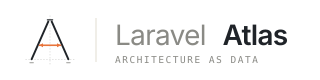
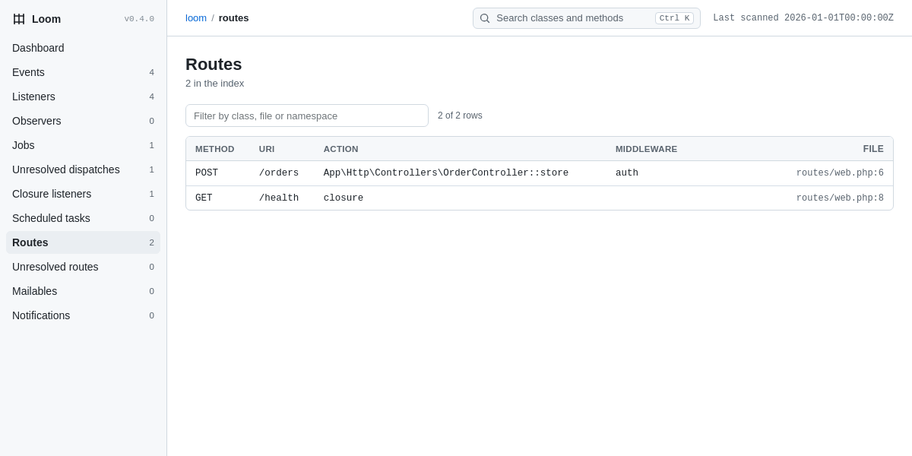

<p align="center">
  <picture>
    <source media="(prefers-color-scheme: dark)" srcset="art/logo-wide-dark.svg">
    
  </picture>
</p>

<p align="center">
  <a href="https://github.com/lucasp1337/laravel-loom/actions/workflows/run-tests.yml"></a>
  <a href="LICENSE.md"></a>
</p>

# Laravel Loom

Events, listeners and queued jobs keep a Laravel app loosely coupled. That works until you have to trace a flow: who fires `OrderPlaced`, what listens, and what does that listener dispatch next? Loom stitches the loose parts back together. It shows where every event, job, mailable and notification is dispatched and who handles it, with a file and line for each hop, so you can follow the app at hundreds of events without clicking through code.



## Quick start

```bash
composer require lucasp1337/laravel-loom --dev
php artisan loom:scan
php artisan loom:show OrderPlaced
```

<!-- generated:output:show-event -->
<!-- Generated by `just docs-generate`; edit the source, not this block. -->

```json
{
    "id": "App\\Events\\OrderPlaced",
    "fqcn": "App\\Events\\OrderPlaced",
    "kind": "class",
    "file": "app/Events/OrderPlaced.php",
    "line": 5,
    "dispatched_from": [
        {
            "file": "app/Http/Controllers/OrderController.php",
            "line": 11,
            "method": "App\\Http\\Controllers\\OrderController::store"
        }
    ],
    "handled_by": [
        {
            "listener": "App\\Listeners\\SendReceipt",
            "method": "handle"
        }
    ]
}
```
<!-- /generated:output:show-event -->

`dispatched_from` is where your code fires the event; `handled_by` is every listener that reacts. [Getting started](docs/getting-started.md) walks through it.

## How does Loom work?

`loom:scan` parses your PHP source. It never boots the app, so it needs no database, queue or `.env` and gives the same result on a laptop and in CI. It links every dispatch to its handlers, and every handler to what it dispatches next.

The result is one JSON file, `storage/loom/index.json`. The UI, the MCP server and the CLI checks read that file, so scan again after you change code. [The index](docs/concepts/the-index.md) explains its shape, and [what Loom sees](docs/concepts/what-loom-sees.md) lists what gets picked up.

## What you can do with it

- Browse the read-only UI at `/loom`. Open an event and follow its chain as a graph, one column per hop. See [browse the UI](docs/guides/browse-the-ui.md).
- Point your coding agent at `php artisan loom:mcp`, so it can ask what fires an event or what a change breaks instead of grepping. See [ask an agent](docs/guides/ask-an-agent.md).
- Gate pull requests with `loom:check`, which fails on dead events or dispatch cycles, and use `loom:diff` to show how the wiring changed between branches. See [gate your CI](docs/guides/gate-your-ci.md).
- Load the index into typed PHP objects for your own scripts. See the [PHP API](docs/reference/php-api.md) and [recipes](docs/recipes/event-chain.md).

## Ask what a change breaks

Asked "What breaks if I delete `SendReceipt`?", an agent calls:

<!-- generated:output:agent-impact -->
<!-- Generated by `just docs-generate`; edit the source, not this block. -->

```json
[
    {
        "tool": "impact-of-change",
        "arguments": {
            "fqcn": "App\\Listeners\\SendReceipt"
        },
        "result": {
            "fqcn": "App\\Listeners\\SendReceipt",
            "change": "remove",
            "kind": "listener",
            "handles": [
                "App\\Events\\OrderPlaced"
            ],
            "would_orphan_events": [
                "App\\Events\\OrderPlaced"
            ],
            "dispatches": [
                {
                    "target": "App\\Events\\ReceiptSent",
                    "kind": "event",
                    "confidence": "high",
                    "file": "app/Listeners/SendReceipt.php",
                    "line": 15
                },
                {
                    "target": "App\\Jobs\\SendMail",
                    "kind": "job",
                    "confidence": "high",
                    "file": "app/Listeners/SendReceipt.php",
                    "line": 16
                },
                {
                    "target": "App\\Mail\\OrderReceipt",
                    "kind": "mailable",
                    "confidence": "high",
                    "file": "app/Listeners/SendReceipt.php",
                    "line": 17
                }
            ],
            "notes": [
                "Removing this class would leave 1 event with no remaining handler: App\\Events\\OrderPlaced.",
                "Downstream dispatches from this class are listed; their own chains are not expanded here."
            ]
        }
    },
    {
        "tool": "dispatch-sites-for",
        "arguments": {
            "event_fqcn": "App\\Events\\OrderPlaced"
        },
        "result": {
            "event": "App\\Events\\OrderPlaced",
            "count": 1,
            "dispatch_sites": [
                {
                    "file": "app/Http/Controllers/OrderController.php",
                    "line": 11,
                    "method": "App\\Http\\Controllers\\OrderController::store"
                }
            ]
        }
    }
]
```
<!-- /generated:output:agent-impact -->

Answer: `OrderPlaced` (fired by `OrderController::store`) loses its only handler; nothing `SendReceipt` dispatches runs.

## What it is not

- Not a runtime tracer. It reports what your source says, not what a request did.
- Not complete for dynamic code. `event($class)` is listed under `unresolved_dispatches` with a file and line instead of guessed.
- Not a style linter. It has no opinion beyond the [check rules](docs/reference/check-rules-and-formats.md).

> [!NOTE]
> Install with `--dev`. The UI, the MCP server and the `viewLoom` gate then disappear from `composer install --no-dev` production builds. The UI is also mounted only in `local` unless you list more environments in `loom.ui.environments`.

## Requirements

- PHP 8.3 or newer
- Laravel 12.41+ or 13

The browser UI needs `livewire/livewire` and `loom:mcp` needs `laravel/mcp`. Neither ships with Loom:

```bash
composer require livewire/livewire laravel/mcp --dev
```

The scan, show, diff and check commands work without them.

## Documentation

The site is at <https://lucasp1337.github.io/laravel-loom/>. Start at [getting started](docs/getting-started.md), or see the [command reference](docs/reference/commands.md) and the [JSON schema](docs/reference/schema.md).

## Security

See [SECURITY.md](SECURITY.md) for supported versions and how to report a vulnerability.

## Contributing

See [CONTRIBUTING.md](CONTRIBUTING.md).

## License

The MIT License (MIT). See [LICENSE.md](LICENSE.md).
