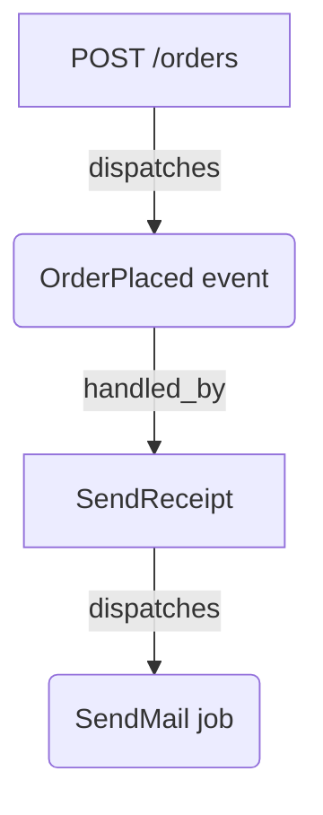

# The index

A scan writes one JSON document, `storage/loom/index.json`: metadata, `stats`, then one array per primitive.

<!-- generated:output:index-shape -->
<!-- Generated by `just docs-generate`; edit the source, not this block. -->

```json
{
  "schema_version": "1.0",
  "loom_version": "0.4.0",
  "scanned_at": "2026-01-01T00:00:00Z",
  "laravel_version": "13.0",
  "stats": {"events":4,"model_events":0,"listeners":4,"observers":0,"jobs":1,"unresolved_dispatches":1,"closure_listeners":1,"scheduled_tasks":0,"routes":2,"unresolved_routes":0,"mailables":1,"notifications":0},
  "events": [ { "...": "..." } ],
  "model_events": [ { "...": "..." } ],
  "listeners": [ { "...": "..." } ],
  "observers": [ { "...": "..." } ],
  "jobs": [ { "...": "..." } ],
  "unresolved_dispatches": [ { "...": "..." } ],
  "closure_listeners": [ { "...": "..." } ],
  "scheduled_tasks": [ { "...": "..." } ],
  "routes": [ { "...": "..." } ],
  "unresolved_routes": [ { "...": "..." } ],
  "mailables": [ { "...": "..." } ],
  "notifications": [ { "...": "..." } ]
}
```
<!-- /generated:output:index-shape -->

Every key is always present and `stats` counts each section. Entries are sorted, so two scans of the same source differ only in `scanned_at`, which keeps [`loom:diff`](../guides/gate-your-ci.md#see-what-changed) output stable. The [schema](../reference/schema.md) has the field-by-field contract.

## Reading a relationship

Every relationship is stored once, on whichever side owns it:

| Field | Lives on | Each item |
| --- | --- | --- |
| `dispatches` | route, listener, job, observer, closure listener | `{target, kind, confidence, file, line}` |
| `handled_by` | event | `{listener, method}` |
| `dispatched_from` | event, job | `{file, line, method}` |
| `sent_from` | mailable | `{file, line, method}` |
| `notified_from` | notification | `{file, line, method}` |

Read an event's `handled_by` for its handlers and a job's `dispatched_from` for its callers. `kind` says what a target is, and [`confidence`](../reference/schema.md#dispatchconfidence) how it was resolved.

## A worked example

`POST /orders` runs `OrderController::store`, which dispatches `OrderPlaced`. `SendReceipt` handles it and dispatches a queued `SendMail` job.



These entries come from a scan of that flow, trimmed to the fields that carry the links. The route:

<!-- generated:output:index-route -->
<!-- Generated by `just docs-generate`; edit the source, not this block. -->

```json
{
    "method": "POST",
    "uri": "/orders",
    "name": "orders.store",
    "controller_fqcn": "App\\Http\\Controllers\\OrderController",
    "controller_method": "store",
    "file": "routes/web.php",
    "line": 6,
    "dispatches": [
        {
            "target": "App\\Events\\OrderPlaced",
            "kind": "event",
            "confidence": "high",
            "file": "app/Http/Controllers/OrderController.php",
            "line": 11
        }
    ]
}
```
<!-- /generated:output:index-route -->

The event:

<!-- generated:output:index-event -->
<!-- Generated by `just docs-generate`; edit the source, not this block. -->

```json
{
    "id": "App\\Events\\OrderPlaced",
    "file": "app/Events/OrderPlaced.php",
    "line": 5,
    "dispatched_from": [
        {
            "file": "app/Http/Controllers/OrderController.php",
            "line": 11,
            "method": "App\\Http\\Controllers\\OrderController::store"
        }
    ],
    "handled_by": [
        {
            "listener": "App\\Listeners\\SendReceipt",
            "method": "handle"
        }
    ]
}
```
<!-- /generated:output:index-event -->

The listener:

<!-- generated:output:index-listener -->
<!-- Generated by `just docs-generate`; edit the source, not this block. -->

```json
{
    "fqcn": "App\\Listeners\\SendReceipt",
    "file": "app/Listeners/SendReceipt.php",
    "line": 11,
    "handles": [
        {
            "event": "App\\Events\\OrderPlaced",
            "method": "handle"
        }
    ],
    "registration": "discovery_unverified",
    "queued": false,
    "dispatches": [
        {
            "target": "App\\Events\\ReceiptSent",
            "kind": "event",
            "confidence": "high",
            "file": "app/Listeners/SendReceipt.php",
            "line": 15
        },
        {
            "target": "App\\Jobs\\SendMail",
            "kind": "job",
            "confidence": "high",
            "file": "app/Listeners/SendReceipt.php",
            "line": 16
        },
        {
            "target": "App\\Mail\\OrderReceipt",
            "kind": "mailable",
            "confidence": "high",
            "file": "app/Listeners/SendReceipt.php",
            "line": 17
        }
    ]
}
```
<!-- /generated:output:index-listener -->

The job:

<!-- generated:output:index-job -->
<!-- Generated by `just docs-generate`; edit the source, not this block. -->

```json
{
    "fqcn": "App\\Jobs\\SendMail",
    "file": "app/Jobs/SendMail.php",
    "line": 7,
    "queued": true,
    "dispatched_from": [
        {
            "file": "app/Listeners/SendReceipt.php",
            "line": 16,
            "method": "App\\Listeners\\SendReceipt::handle"
        }
    ]
}
```
<!-- /generated:output:index-job -->

The route's `dispatches` names `OrderPlaced`, whose `handled_by` names `SendReceipt`, whose `dispatches` names `SendMail`. Read backward, `SendMail.dispatched_from` points at `SendReceipt::handle`. A closure registered for `OrderPlaced` is not in `handled_by`: it has its own `closure_listeners` entry.

Commit the index if you want a baseline to [diff and check](../guides/gate-your-ci.md) a branch against; otherwise add it to `.gitignore`. The [PHP API](../reference/php-api.md) reads it as typed objects.
