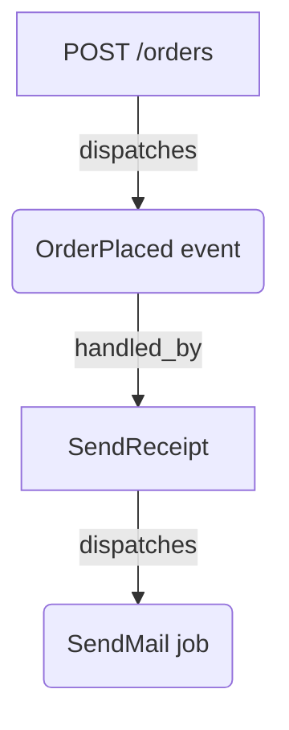

# The index

Someone who has run `loom:scan`, opened the JSON and wants to read it without the schema open.

A scan writes one JSON document, `storage/loom/index.json`. This page shows how to read it; the [schema](../reference/schema.md) has the field-by-field contract.

## The shape of the document

The index opens with metadata and a `stats` block, then carries one array per primitive:

<!-- generated:output:index-shape -->
<!-- Generated by `just docs-generate`; edit the source, not this block. -->

```json
{
  "schema_version": "1.0",
  "loom_version": "0.4.0",
  "scanned_at": "2026-01-01T00:00:00Z",
  "laravel_version": "13.0",
  "stats": {"events":4,"model_events":0,"listeners":4,"observers":0,"jobs":1,"unresolved_dispatches":1,"closure_listeners":1,"scheduled_tasks":0,"routes":2,"unresolved_routes":0,"mailables":0,"notifications":0},
  "events": [ { "...": "..." } ],
  "model_events": [ { "...": "..." } ],
  "listeners": [ { "...": "..." } ],
  "observers": [ { "...": "..." } ],
  "jobs": [ { "...": "..." } ],
  "unresolved_dispatches": [ { "...": "..." } ],
  "closure_listeners": [ { "...": "..." } ],
  "scheduled_tasks": [ { "...": "..." } ],
  "routes": [ { "...": "..." } ],
  "unresolved_routes": [ { "...": "..." } ],
  "mailables": [ { "...": "..." } ],
  "notifications": [ { "...": "..." } ]
}
```
<!-- /generated:output:index-shape -->

All keys are always present. Empty arrays are valid; a `null` array never is. `loom_version` is the version of Loom that wrote the file, and `stats` counts the entries in each section.

Entries are sorted, so two scans of the same source produce byte-identical files apart from `scanned_at`. That's what makes [`loom:diff`](../guides/gate-your-ci.md) stable and order-independent, and it's why committing the index gives you readable diffs.

## Reading a relationship

The interesting part is how entries point at each other. Every relationship is stored once, on whichever side owns it:

| Field | Lives on | Each item |
| --- | --- | --- |
| `dispatches` | route, listener, job, observer, closure listener | `{target, kind, confidence, file, line}` |
| `handled_by` | event | `{listener, method}` |
| `dispatched_from` | event, job | `{file, line, method}` |
| `sent_from` | mailable | `{file, line, method}` |
| `notified_from` | notification | `{file, line, method}` |

To answer "who handles this event?", read its `handled_by`. To answer "where is this job dispatched?", read its `dispatched_from`. You never reconcile two copies of the same fact.

`kind` says what the target is (`event` or `job` on a cross-linked `dispatches` item). `confidence` is always `high` today: every target Loom writes was resolved statically, and `medium` and `low` are reserved values. Don't read `high` as "verified at runtime".

## A worked example

Consider one flow: `POST /orders` runs `OrderController::store`, which dispatches `OrderPlaced`. `SendReceipt` handles it and dispatches a queued `SendMail` job.



The snippets below come from a scan of that flow, trimmed to the fields that carry the links. Real entries have a few more.

The route records the event its controller method fires:

<!-- generated:output:index-route -->
<!-- Generated by `just docs-generate`; edit the source, not this block. -->

```json
{
    "method": "POST",
    "uri": "/orders",
    "name": "orders.store",
    "controller_fqcn": "App\\Http\\Controllers\\OrderController",
    "controller_method": "store",
    "file": "routes/web.php",
    "line": 6,
    "dispatches": [
        {
            "target": "App\\Events\\OrderPlaced",
            "kind": "event",
            "confidence": "high",
            "file": "app/Http/Controllers/OrderController.php",
            "line": 11
        }
    ]
}
```
<!-- /generated:output:index-route -->

The event records who handles it and where it's dispatched from:

<!-- generated:output:index-event -->
<!-- Generated by `just docs-generate`; edit the source, not this block. -->

```json
{
    "id": "App\\Events\\OrderPlaced",
    "file": "app/Events/OrderPlaced.php",
    "line": 5,
    "dispatched_from": [
        {
            "file": "app/Http/Controllers/OrderController.php",
            "line": 11,
            "method": "App\\Http\\Controllers\\OrderController::store"
        }
    ],
    "handled_by": [
        {
            "listener": "App\\Listeners\\SendReceipt",
            "method": "handle"
        }
    ]
}
```
<!-- /generated:output:index-event -->

The listener records the job it dispatches:

<!-- generated:output:index-listener -->
<!-- Generated by `just docs-generate`; edit the source, not this block. -->

```json
{
    "fqcn": "App\\Listeners\\SendReceipt",
    "file": "app/Listeners/SendReceipt.php",
    "line": 9,
    "handles": [
        {
            "event": "App\\Events\\OrderPlaced",
            "method": "handle"
        }
    ],
    "registration": "discovery_unverified",
    "queued": false,
    "dispatches": [
        {
            "target": "App\\Events\\ReceiptSent",
            "kind": "event",
            "confidence": "high",
            "file": "app/Listeners/SendReceipt.php",
            "line": 13
        },
        {
            "target": "App\\Jobs\\SendMail",
            "kind": "job",
            "confidence": "high",
            "file": "app/Listeners/SendReceipt.php",
            "line": 14
        }
    ]
}
```
<!-- /generated:output:index-listener -->

The job records where it's dispatched from:

<!-- generated:output:index-job -->
<!-- Generated by `just docs-generate`; edit the source, not this block. -->

```json
{
    "fqcn": "App\\Jobs\\SendMail",
    "file": "app/Jobs/SendMail.php",
    "line": 7,
    "queued": true,
    "dispatched_from": [
        {
            "file": "app/Listeners/SendReceipt.php",
            "line": 14,
            "method": "App\\Listeners\\SendReceipt::handle"
        }
    ]
}
```
<!-- /generated:output:index-job -->

Follow the links. The route's `dispatches` names `OrderPlaced`. `OrderPlaced.handled_by` names `SendReceipt`, whose `dispatches` names `SendMail`. Going back, `SendMail.dispatched_from` points at `SendReceipt::handle`, and `OrderPlaced.dispatched_from` points at `OrderController::store`. The same flow read forward and backward, with each fact stored once.

!!! note "Closure listeners sit outside this chain"
    If a provider also registers a closure for `OrderPlaced`, it doesn't appear in `handled_by`. It has its own entry under `closure_listeners`, keyed by the event. See [what Loom sees](what-loom-sees.md) for why.

## Keeping the file

Add `storage/loom/index.json` (or your configured `index_path`) to `.gitignore` if you only read it locally. Commit it if you want a baseline that [`loom:diff` and `loom:check`](../guides/gate-your-ci.md) can compare a branch against.

## Where next

- [Schema](../reference/schema.md): the full contract for every section.
- [PHP API](../reference/php-api.md): read the index as typed objects instead of arrays.
- [What Loom sees](what-loom-sees.md): what each section means and what Loom can't resolve.
