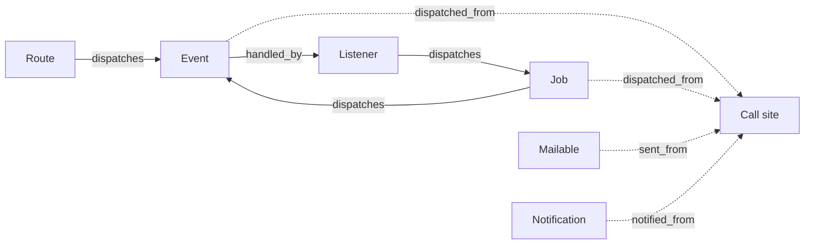

# What Loom sees

Someone who has scanned an app and wants to know what ended up in the index and what didn't.

## The wiring problem

Take one event in a checkout app. `OrderController::store` fires it:

```php
event(new OrderPlaced($order->id));
```

`SendOrderConfirmation` reacts to it. Nothing registers that listener; its only link to the event is the type hint:

```php
public function handle(OrderPlaced $event): void
{
    SendReceipt::dispatch($event->orderId);
}
```

A provider adds a second reaction as a closure:

```php
Event::listen(OrderPlaced::class, function (OrderPlaced $event) {
    logger('order placed');
});
```

Three files, three registration styles, and no place that says "these are the reactions to `OrderPlaced`". Grepping finds the `event()` call and the closure, but not the listener, because its only link to the event is a type hint. That works fine until the app has a few hundred events.

Loom reads the source, follows each of those links, and writes them into one index. It never boots your app, so it records what your code says, not what a particular request did.

## What Loom records

Each primitive gets its own section in the index, and every entry carries a file and a line. The [schema](../reference/schema.md) has the exact fields and [What Loom detects](../reference/detection/index.md) shows the code shapes each scanner reads, as tested examples.

| Primitive | Section | Found through |
| --- | --- | --- |
| Events | `events` | Classes under an `Events/` directory, classes passed to `event()`, `broadcast()` or `Event::dispatch()`, and classes a model names in `$dispatchesEvents` |
| Listeners | `listeners` | Auto-discovery, the `$listen` array, `Event::listen()` calls and subscribers |
| Closure listeners | `closure_listeners` | A closure or arrow function passed to `Event::listen()` |
| Observers | `observers` | `Model::observe()`, `#[ObservedBy]` and `eloquent.*` listeners |
| Model events | `model_events` | The lifecycle hooks an observer implements |
| Jobs | `jobs` | Classes under `Jobs/` and classes you dispatch |
| Mailables | `mailables` | Classes under `Mail/` and classes passed to `Mail::to()->send()` |
| Notifications | `notifications` | Classes under `Notifications/` and classes passed to `notify()` or `Notification::send()` |
| Scheduled tasks | `scheduled_tasks` | `Kernel::schedule()`, `withSchedule()` and `Schedule::*` chains |
| Routes | `routes` | Registrations in your route files, including the routes a `Route::resource()` expands into |

A few details change how you read an entry.

**Events.** Each event lists the listeners that handle it and the sites that dispatch it. `OrderPlaced::dispatch()` only counts for a class under `Events/`: the same call on a class elsewhere is read as a job, because that form is how jobs are dispatched too.

**Listeners.** Loom finds them four ways: auto-discovery of public `handle*` and `__invoke` methods (declared, inherited or from a trait), the `$listen` array on a provider, `Event::listen()` calls (including a dispatcher resolved from the container) and subscribers. In `$listen` and `Event::listen()` a listener can be written as `SendReceipt::class`, `[SendReceipt::class, 'handle']`, `Closure::fromCallable([...])` or the first-class callable `SendReceipt::handle(...)`. They all link the same way.

**Closure listeners.** A closure has no class name, so its entry records the event it handles and where the closure starts and ends.

**Observers and model events.** An observer entry records the model and the lifecycle hooks the observer implements. The lifecycle events themselves show up as `model_events` entries that link a model and an event such as `created` back to its handlers.

**Jobs.** Loom locates dispatched classes through your PSR-4 autoload map, so domain-driven layouts work. Each entry records whether the job is queued and the queue settings the class declares as literal properties.

**Notifications.** A notification also records its delivery channels when `via()` returns a literal array.

**Scheduled tasks.** Frequencies are normalized to a five-field cron expression. The sub-minute helpers such as `everyFiveSeconds()` don't fit one, so their `cron` is `null` and `frequency` holds the interval in seconds.

**Routes.** Each route records its method, URI, name, controller action and middleware, and the events and jobs its controller method dispatches. That last link is what lets you start from a URL and end at an event.

**Dispatch sites.** Every call that fires an event, job, mailable or notification. They aren't a section of their own. Each one appears on the thing it fires, as `dispatched_from`, `sent_from` or `notified_from`, and on the class or route that contains the call, as `dispatches`.

## How the sections connect

Loom finishes reading every file before it links anything, so a listener can point at an event that was scanned after it. Each relationship is stored on one side only, and [the index](the-index.md) shows how to read it from both directions.



Solid edges are stored on the source (a route, listener or job lists what it dispatches). Dashed edges are the reverse, stored on the target so you can ask "who fires this?" without scanning every entry.

## What Loom can't see

A class picked at runtime has no name in the source. Loom lists each such call in `unresolved_dispatches` or `unresolved_routes`, with its file, line and a `reason`, instead of dropping it. [What Loom detects](../reference/detection/index.md) shows each form it reads and each one it does not, and its [reason table](../reference/detection/index.md#unresolved-reasons) leads from a `reason` to the code that produces it. [`loom:check`](../guides/gate-your-ci.md) can watch how many there are.

If something you expected is missing, start at [Why was my code missed?](../guides/why-was-my-code-missed.md).
